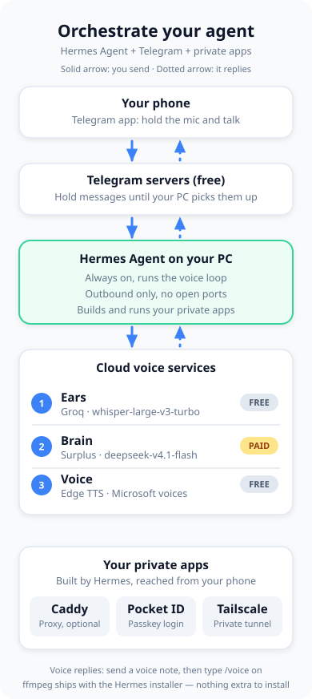

# Getting Started AI — Hermes on Windows

An agent-executable roadmap for standing up a private AI assistant on a native Windows 10/11 x64 PC: **Hermes Agent** talking Telegram voice notes in and spoken replies out, running 24/7 after reboot, with Pocket ID single sign-on guarding private web services, all reachable from the phone through Tailscale. Every cloud dependency is free-tier or prepaid by the owner; the roadmap is written so an AI agent can execute it top-to-bottom, with the few unavoidable human steps (bot token, signups, passkey enrollment) explicitly marked **HUMAN STEP**.

## Accounts & keys

Source: RESEARCH.md §1. Secrets live ONLY in `%LOCALAPPDATA%\hermes\.env` — never Windows user env vars.

| # | Account | Who creates it | Cost | What to create | Env var |
|---|---------|----------------|------|----------------|---------|
| 1 | [Surplus Intelligence](https://www.surplusintelligence.ai) | **USER** hands over the working key (`inf_`-prefixed); the friend creates NO account | $0 signup; prepaid usage (USDC on Base or card credit) | Nothing | `SURPLUS_API_KEY` |
| 2 | [Groq](https://console.groq.com) (key at console.groq.com/keys) | Friend — signup is a **HUMAN STEP** | Free tier, no card | Account + 1 API key | `GROQ_API_KEY` |
| 3 | [Telegram @BotFather](https://t.me/BotFather) | Friend — **HUMAN STEP** (BotFather chat, `/newbot`, username must end `bot`; token shown once, `/revoke` if leaked) | Free | 1 bot + token `123456789:ABCdef...` | `TELEGRAM_BOT_TOKEN` |
| 4 | [Tailscale](https://login.tailscale.com) | Friend — **HUMAN STEP** (same login on PC and Android) | Personal plan free: up to 6 users, unlimited user devices, no card | Free tailnet; Windows client + Android app (com.tailscale.ipn) | none (GUI login) |
| 5 | [Cloudflare](https://dash.cloudflare.com/sign-up) (OPTIONAL, custom-domain routing only) | Friend — **HUMAN STEP** (optional; domain buy too) | $0 DNS; domain at-cost (.com $10.46/yr at registrar.cloudflare.com; .se NOT sold by Cloudflare — buy elsewhere, point NS at Cloudflare) | Free account; API token `Zone→DNS→Edit` + `Zone→Zone→Read`, scoped to zone, `cfut_`-prefixed | `CLOUDFLARE_DNS_API_TOKEN` |
| 6 | Edge TTS | Nobody — no account, no key | $0 | Nothing — Hermes default TTS | none |
| 7 | Hermes Agent | Nobody | $0 open source; Nous Portal is OPTIONAL paid — NOT used here | No account | — |

Optional tool keys (`FIRECRAWL_API_KEY`, `BROWSER_USE_API_KEY`, `FAL_KEY`, `ELEVENLABS_API_KEY`) stay unset. Telegram `TELEGRAM_ALLOWED_USERS` = the friend's numeric user id (get it from @userinfobot) — NEVER `TELEGRAM_ALLOW_ALL_USERS`.

## Architecture

The blue path is the voice loop: voice note → Telegram API → Hermes gateway → Groq STT → Surplus LLM → Edge TTS → ffmpeg → voice bubble back in Telegram. Green labels are free tier; orange is the one prepaid service (Surplus, paid by the user).

## Repo map

| File | Covers |
|---|---|
| `RESEARCH.md` | Single source of truth — verified facts, URLs, costs, commands. Read first. |
| `skills/01-prerequisites-and-accounts.md` | Windows 10/11 x64 checks, PowerShell (no admin), accounts/keys from §1, secret handling, .env rules |
| `skills/02-install-hermes.md` | Hermes PowerShell installer, PATH verification, Surplus LLM config (config.yaml), Groq STT, Edge TTS |
| `skills/03-telegram-voice-gateway.md` | `hermes gateway setup` (Telegram), voice mode `/voice on|tts|off`, `hermes gateway install` schtasks autostart, status/restart |
| `skills/04-tailscale-and-pocket-id.md` | Tailscale PC+phone install, MagicDNS/HTTPS certs, `tailscale serve --bg 1411`, Pocket ID Windows binary (checksum, `.env` APP_URL/ENCRYPTION_KEY, firewall), first-run passkey, recovery, OIDC client |
| `skills/05-private-web-routing.md` | Option B `tailscale serve` default; optional Option A Caddy+Cloudflare DNS-01 wildcard, Caddyfile, service persistence |
| `skills/06-verification-and-troubleshooting.md` | End-to-end acceptance checklist, troubleshooting table, maintenance (updates, key rotation, backup) |

## Cost summary

Everything is $0: Hermes open source, Edge TTS keyless, Groq free tier, Tailscale personal plan, Cloudflare DNS (only if the optional custom-domain phase runs). The only money ever spent: Surplus usage, prepaid by the user; optional domain ~$10.46/yr if Phase 4 is run.

Source note: RESEARCH.md §1, §2, §3, §4.
