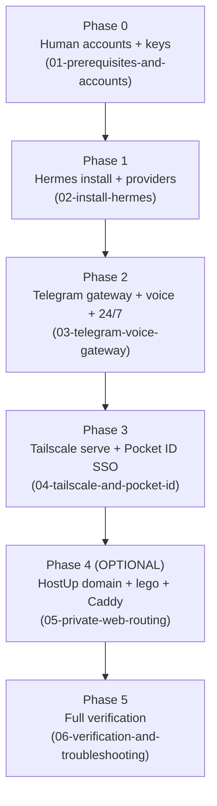

# ROADMAP — Hermes on Windows, one-shot execution

The agent executes phases top-to-bottom. Phases map 1:1 to `skills/` files. Facts come from `RESEARCH.md` (source of truth); every phase has observable exit criteria — never skip a Verification block.



## Phase 0 — Human account creation (RESEARCH.md §1)

**Skill:** `skills/01-prerequisites-and-accounts.md`
**Goal:** All keys collected into one handoff; nothing left to guess mid-install.
**Estimated wall time:** 20 min (human-paced; agent can batch this before Phase 1)

**HUMAN STEPS (agent must stop and request; cannot be automated):**
1. USER hands over `SURPLUS_API_KEY` (`inf_`-prefixed) — no account creation by friend.
2. Friend signs up at https://console.groq.com → create key at console.groq.com/keys.
3. Friend chats https://t.me/BotFather → `/newbot` (username ends `bot`); copy token shown ONCE (`123456789:ABCdef...`); `/revoke` if leaked.
4. Friend gets their numeric Telegram user id from @userinfobot.
5. Friend creates free Tailscale tailnet at https://login.tailscale.com (same login later on PC + Android).
6. (OPTIONAL, only if Phase 4 runs) Friend buys domain at HostUp (hostup.se — `.se` natively supported) + creates HostUp API key with scopes `read:dns`, `write:dns`, `read:domains`.

**Agent-completable (no human):**
- Edge TTS: nothing to create — no account, no key.
- Hermes Agent: no account; Nous Portal is OPTIONAL paid — NOT used.
- Verify Surplus key live: `curl https://api.surplusintelligence.ai/v1/models` with `Authorization: Bearer <key>` — expect 200 and `deepseek-v4.1-flash` in list.

**Inputs:** none yet.
**Exit criteria:** `SURPLUS_API_KEY`, `GROQ_API_KEY`, `TELEGRAM_BOT_TOKEN`, `TELEGRAM_ALLOWED_USERS` values known; Tailscale login credentials available; (optional) `HOSTUP_API_KEY` + domain name recorded. Secrets still only in a temporary local scratch — never committed, never echoed.

## Phase 1 — Hermes install + provider config (RESEARCH.md §2)

**Skill:** `skills/02-install-hermes.md`
**Goal:** Hermes Agent running on native Windows x64, LLM/STT/TTS all pointed at cloud providers, one real round-trip reply proven.
**Inputs:** `SURPLUS_API_KEY`, `GROQ_API_KEY`.
**Skill file:** `skills/02-install-hermes.md`
**Estimated wall time:** 15 min.

**Steps (detail in skill file):**
1. PowerShell (NO admin): `iex (irm https://hermes-agent.nousresearch.com/install.ps1)` — installs to `%LOCALAPPDATA%\hermes\`, bundles uv/Python 3.14/Node/npm/ripgrep/FFmpeg/Git. No prerequisites.
2. Open a NEW PowerShell window (PATH refresh). Verify: `Get-Command hermes`; `hermes --version`. Fallback if `'hermes' is not recognized`: `& "$env:LOCALAPPDATA\hermes\bin\hermes.exe"`.
3. Write `%LOCALAPPDATA%\hermes\config.yaml`:
   ```yaml
   providers:
     surplus:
       api: https://api.surplusintelligence.ai/v1
       key_env: SURPLUS_API_KEY
   model:
     default: deepseek-v4.1-flash
     provider: custom:surplus
   stt:
     enabled: true
     provider: groq        # MUST pin — auto-fallback is local > groq > openai
     groq:
       language: ''
   tts:
     provider: edge
     edge:
       voice: en-US-AriaNeural
   ```
4. Write secrets to `%LOCALAPPDATA%\hermes\.env` ONLY (never Windows user env vars): `SURPLUS_API_KEY`, `GROQ_API_KEY`.
5. Repair policy: never delete `%LOCALAPPDATA%\hermes` — use `hermes uninstall` (`--dry-run` first).

**Exit criteria (observable):**
- `hermes --version` prints a version.
- One chat turn in `hermes` returns a reply routed via Surplus (`deepseek-v4.1-flash`).
- STT round-trip on a small audio file succeeds via Groq (rate limits are ample: 20 RPM, 2000 req/day, 28800 audio-sec/day).

## Phase 2 — Telegram gateway + voice + 24/7 (RESEARCH.md §2)

**Skill:** `skills/03-telegram-voice-gateway.md`
**Goal:** Phone ⇄ PC voice loop working; gateway survives reboot unattended.
**Inputs:** `TELEGRAM_BOT_TOKEN`, friend's Telegram numeric user id (Phase 0).
**Skill file:** `skills/03-telegram-voice-gateway.md`
**Estimated wall time:** 20 min (+ one reboot cycle).

**Steps (detail in skill file):**
1. `hermes gateway setup` → select Telegram → paste token + allowed user id (writes `.env`). Alternative: dashboard Messaging → Telegram "Create with QR".
2. Start: `hermes gateway` — outbound long-polling, no ports, works behind home NAT.
3. In bot chat: send a voice note → confirm text appears; `/voice on` for spoken replies; `/voice tts` for spoken reply to everything; `/voice off`, `/voice status` exist; setting persists across restarts.
4. Autostart (ONLY on explicit action): `hermes gateway install` → schtasks ONLOGON task `Hermes_Gateway` (/RL LIMITED, no admin/UAC).
5. Manage: `hermes gateway status|start|stop|restart|uninstall`.

**Exit criteria (observable):**
- Voice note in Telegram bot chat → spoken voice reply arrives as a voice bubble (FFmpeg MP3→Opus, bundled).
- `/voice status` reflects chosen mode.
- After full reboot and login, `hermes gateway status` shows running WITHOUT manual start.

## Phase 3 — Tailscale serve HTTPS + Pocket ID SSO (RESEARCH.md §3, §4-Option B)

**Skill:** `skills/04-tailscale-and-pocket-id.md`
**Goal:** Passkey-protected Pocket ID reachable at `https://<machine>.tailnet.ts.net` from the phone over Tailscale.
**Inputs:** Tailscale login (Phase 0); no new keys.
**Skill file:** `skills/04-tailscale-and-pocket-id.md`
**Estimated wall time:** 30 min (incl. one HUMAN passkey enrollment).

**Steps (detail in skill file):**
1. Install Tailscale Windows client (https://tailscale.com/docs/install/windows) + Android app `com.tailscale.ipn` — same tailnet login both. One-time in Tailscale admin console → DNS: enable MagicDNS + HTTPS Certificates.
2. Download Pocket ID v2.18.0 Windows binary: https://github.com/pocket-id/pocket-id/releases/latest/download/pocket-id_windows_amd64.exe (verify checksums.txt; amd64 NOT arm64). Single Go binary, embedded SQLite (`data/` with pocket-id.db + uploads/ in working dir).
3. `.env` next to exe: `APP_URL=https://<machine>.tailnet-name.ts.net` (exact final URL, no path — passkeys bind to it; changing later invalidates them) + `ENCRYPTION_KEY` (≥16 bytes, e.g. `openssl rand -base64 32`). PUBLIC_URL does not exist (renamed APP_URL in v1); omit APP_ENV. `PORT` default 1411.
4. Pre-authorize inbound 1411 in Windows Firewall (`netsh advfirewall`) to avoid interactive popup on first run [INFERENCE: standard Windows behavior].
5. `tailscale serve --bg 1411` → HTTPS with auto Let's Encrypt cert. Status: `tailscale serve status`. (Later services are ADDED as more mappings — never `serve reset` unless a full wipe is intended; see skill 05.)
6. Run `.\pocket-id.exe`.
7. **HUMAN STEP — inherently interactive, no default admin credentials exist:** open `APP_URL/setup`, create account, enroll passkey.
8. Recovery path (document, don't run): `.\pocket-id.exe one-time-access-token <username>` → `/lc/<token>` URL valid 1h.
9. OIDC client (for the first protected app): Administration → OIDC Clients → Add (name, callback URL from app docs) → client ID/secret + discovery URL `https://<machine>.ts.net/.well-known/openid-configuration`. New clients allow NO ONE by default → Access tab → All Users or group. Scopes: `openid profile email`.

**Exit criteria (observable):**
- From phone (Tailscale on): `https://<machine>.ts.net` loads Pocket ID login over valid HTTPS.
- Passkey sign-in works; enrollment completed.
- Discovery URL returns `openid-configuration` JSON.

## Phase 4 (OPTIONAL) — HostUp DNS + lego wildcard + Caddy (RESEARCH.md §4-Option A)

**Skill:** `skills/05-private-web-routing.md`
**Goal:** Arbitrary subdomains of a real domain (`agent.example.com`, ...) routed to PC services over Tailscale, with wildcard DNS-01 TLS. Skip entirely unless the friend bought a domain.
**Inputs:** domain (HostUp — `.se` natively supported), `HOSTUP_API_KEY` (Phase 0 optional item).
**Skill file:** `skills/05-private-web-routing.md`
**Estimated wall time:** 45 min.

**Steps (detail in skill file):**
1. Domain at HostUp (client area; DNS zone auto-created). HostUp API key with scopes `read:dns`, `write:dns`, `read:domains`.
2. Key file (not env var, not Hermes .env): `C:\caddy\secrets\hostup_api_key`, read by lego via `HOSTUP_API_KEY_FILE`.
3. Install lego from GitHub releases zip (NOT winget — lego is not in the catalog) to `C:\caddy\lego\`. Issue with a pinned `--path C:\caddy\lego`: `lego --path C:\caddy\lego --dns hostup -d "*.example.com" -d example.com run`. Daily renew task uses the SAME `--path` + `HOSTUP_API_KEY_FILE`, then `caddy reload`.
4. HostUp DNS: wildcard A record `*` → PC's Tailscale IP (`tailscale ip -4`). Optional AAAA via `tailscale ip -6`. Specific records override the wildcard. (Headless alternative: `POST /api/v2/dns-zones/{id}/records`.)
5. Install Caddy — STANDARD winget build works (no custom module needed; lego already fetched the cert). Caddyfile serves the lego cert files from `C:\caddy\lego\certificates\` (`auto_https off`), one `@host`/`handle` pair per subdomain.
6. Always-on: NSSM service or Task Scheduler at startup.
7. Recommendation remains Option B first (`tailscale serve`, zero cost, 2 commands); Phase 4 only if the domain exists.

**Exit criteria (observable):**
- `https://agent.example.com` resolves from phone over Tailscale, valid padlock (DNS-01 wildcard cert).
- Pocket ID (or another backend) answers behind the reverse proxy.
- After reboot, Caddy service is running without manual start.

## Phase 5 — Full verification checklist (RESEARCH.md §2, §3, §4)

**Skill:** `skills/06-verification-and-troubleshooting.md`
**Goal:** Prove the entire stack end-to-end in one pass; capture maintenance runbook.
**Inputs:** everything from Phases 1–4.
**Skill file:** `skills/06-verification-and-troubleshooting.md`
**Estimated wall time:** 15 min.

Checks (detail in skill file) — every one must pass:
1. `hermes --version` works in a fresh PowerShell window.
2. Chat round-trip via Surplus `deepseek-v4.1-flash`.
3. Groq STT transcribes a voice note; Edge TTS replies as Telegram voice bubble.
4. `/voice status` persists after gateway restart.
5. After reboot: `hermes gateway status` running without manual start.
6. `https://<machine>.ts.net` loads Pocket ID; passkey login works from phone.
7. OIDC discovery URL returns JSON; protected app respects Pocket ID SSO.
8. (If Phase 4 ran) wildcard-domain route loads with valid cert after reboot.
Plus: consolidated troubleshooting table (PATH, UTF-8, Telegram photo backslash bug, 20 MB Bot API / 25 MB Groq caps, gateway-after-reboot, APP_URL mismatch, recovery token, ALLOW_DOWNGRADE) and maintenance (updates, key rotation, backup of `.env` + data dirs).

**Exit criteria:** all 8 checks pass in one session; any failure stops the run per the contract below.

---

## One-shot execution contract for the agent

1. Read `CONTEXT.md`, then `RESEARCH.md`, then ALL files in `skills/` BEFORE executing anything.
2. Run phases strictly in order 0 → 1 → 2 → 3 → (4 if domain exists) → 5; a phase starts only when the previous phase's exit criteria are met.
3. NEVER skip a Verification block; a phase is done only when its exit criteria are observably true.
4. On the FIRST failed verification: STOP, record phase, step, exact error, and report to the user. Do not improvise fixes outside the skill files.
5. Mark and wait on every **HUMAN STEP** (Phase 0 keys, Phase 3 passkey enrollment) — never fabricate credentials.
6. Secrets go ONLY into `%LOCALAPPDATA%\hermes\.env` (Hermes) and the Pocket ID `.env` next to its exe — never into Windows user env vars, logs, or committed files.

Source note: RESEARCH.md §1–§4.
